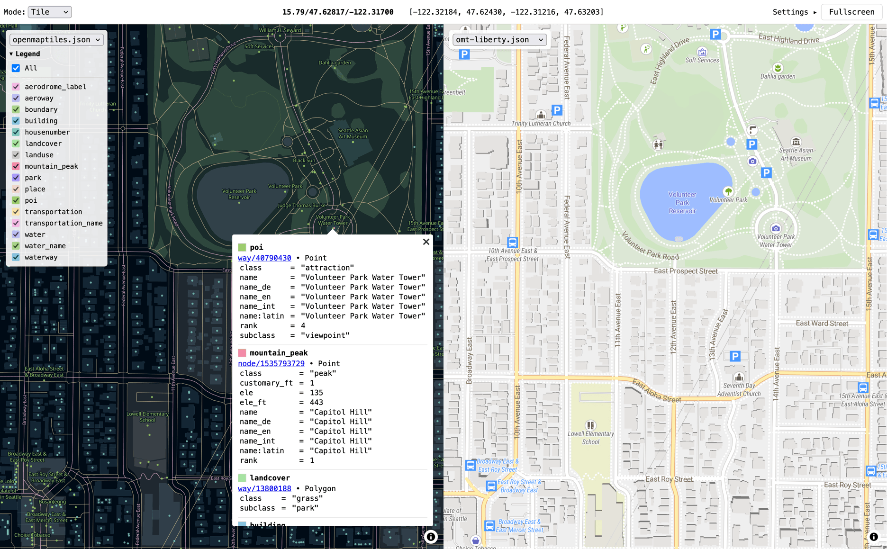

# mapview

`mapview` is a command line tool that lets you view many kinds of geospatial data files in your web browser. Point it at a file and it opens an interactive map in a new browser tab.



_Mapview UI showing a vector tileset in wireframe view, side-by-side with a stylesheet that uses that tileset_

Mapview supports many different file types:

- GeoJSON
- TileJSON
- StyleJSON (MapLibre/Mapbox stylesheets)
- PMTiles
- MBTiles
- GeoTIFF (requires the `gdal` build feature)
- GPX
- KML
- Shapefile

For each supported file type, mapview attempts to "do the right thing" to display it in a useful way. Vector tilesets are shown in a wireframe style that reveals the data contained within them. Map stylesheets are rendered faithfully, with additional details about the visible elements available on click. Vector data formats like GeoJSON and Shapefile are shown as an overlay above your choice of basemap. Raster formats are shown reprojected and tiled automatically to support panning and zooming.

## Features

- Supports either local file paths or remote HTTP(S) URLs for most formats
- View and compare multiple files side by side, in single, swipe, or tile mode
- Use Cmd/Ctrl + F to filter features by a JS expression and highlight matches on the map
- Top bar shows zoom/latitude/longitude and bbox
- Right click to copy a coordinate, measure distance, or copy features as GeoJSON
- Show/hide individual layers in a tileset from the legend panel
- Enable debug tools, map rotation, pitch, or globe mode from the settings panel
- Use `--watch` to automatically reload the page when files are modified

## Usage

View a single file:

```bash
mapview path/to/file.geojson
```

Pipe JSON-based data in via stdin (auto-detects GeoJSON vs TileJSON vs StyleJSON):

```bash
cat file.geojson | mapview
```

View multiple files together in a side-by-side comparison mode:

```bash
mapview path/to/file.geojson another/file.pmtiles a/third/style.json
```

The server runs on `http://localhost:3857` and opens in your default browser automatically.

## Building from source

Mapview is implemented in Rust and TypeScript. The Rust part is a CLI program that launches a local Rocket web server which serves the files given as command line arguments, then opens your browser. The TypeScript part runs in your browser, fetching data from that server and displaying it. Rendering is handled by MapLibre GL JS, and the UI is written in Crank.js.

To build, you will need:
- a Rust toolchain
- Node.js + npm
- Make (GNU or BSD)

GeoTIFF support depends on [GDAL](https://gdal.org) which is disabled by default. You can opt in with `cargo build --features gdal`.

Once compiled, mapview is a single self-contained binary (the HTML, CSS, and JS are embedded into the executable), so to install it, you can just move it to `/usr/local/bin` or equivalent.

## Alternatives

Mapview overlaps with a number of existing web-based tools. Depending on your needs, you may prefer:

- [geojson.io](https://geojson.io) for viewing and editing GeoJSON
- [pmtiles.io](https://pmtiles.io) for inspecting PMTiles archives
- [mapshaper.org](https://mapshaper.org) for viewing, simplifying and converting vector data
- [stamen.github.io/maperture](https://stamen.github.io/maperture) for viewing and comparing map styles
- [gpx.studio](https://gpx.studio/) for viewing and editing GPX files

## License

Mapview is made available under the ISC License. See the [LICENSE](./LICENSE) file for details.
